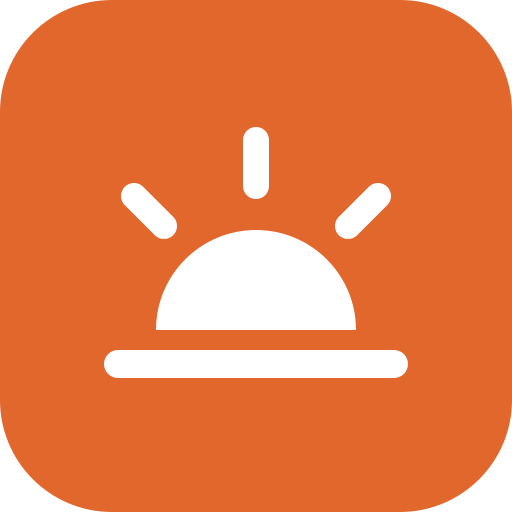

<p align="center">
  
</p>

<h1 align="center">Daylight</h1>

<p align="center">
  <b>Your whole day in one calm tab.</b><br>
  Tasks · Focus timer · Habits · Notes. Private, offline, no sign-up, no build step.
</p>

<p align="center">
  <a href="https://vishantuwuw.github.io/99-night-in-the-forrest/"><b>▶ Open Daylight</b></a>
</p>

<p align="center">
  
  
</p>

## Why

Most productivity apps want an account, a subscription, and your data. Daylight is
one small page you keep open all day: what you're doing today, a timer to do it,
the habits you're building, and a scratchpad. Nothing leaves your browser.

## Features

- **Today list.** Add, finish, and edit tasks (double-click). Unfinished tasks **roll over to tomorrow** automatically, tagged "from yesterday", so nothing gets lost.
- **Focus timer.** Pomodoro-style focus and break sessions with a progress ring, the countdown in the tab title, a chime and a desktop notification. It keeps running if you reload.
- **Habits.** Seven-day check grid with 🔥 streaks.
- **Daily notes.** An auto-saving scratchpad for each day, with past days a click away.
- **Keyboard first.** `n` task · `h` habit · `w` notes · `f` timer · `t` theme · `?` help.
- **Private by design.** Your data lives in `localStorage`. No server, no analytics, no cookies.
- **Works offline and installs as an app** (PWA) on desktop and mobile.
- **Light and dark mode**, following your system or set by hand.
- **Your data stays yours.** Export and import JSON at any time.
- **Tabs stay in sync.** Open it in two tabs and they keep each other up to date.
- **Zero dependencies.** Under 1,000 lines of plain HTML, CSS and JS.

## Use it

**Online:** open the link above. To install it, use "Install app" in your browser menu (or "Add to Home Screen" on a phone).

**Make it your new tab page:** set the link as your homepage, or use any "custom new tab URL" extension.

**Run locally:**

```sh
git clone https://github.com/vishantuwuw/99-night-in-the-forrest.git
cd 99-night-in-the-forrest/app
npx serve .        # or: python3 -m http.server
```

Opening `app/index.html` straight from disk also works (everything except offline mode).

**Self-host:** copy the `app/` folder to any static host. This repo deploys it to GitHub Pages
automatically on every push to `main` (`.github/workflows/pages.yml`).

## Contributing

Issues and PRs are welcome. The rules are short: no dependencies, no build step, no tracking.
Keep it small enough that one person can read the whole thing in an afternoon.

## License

[MIT](LICENSE)
