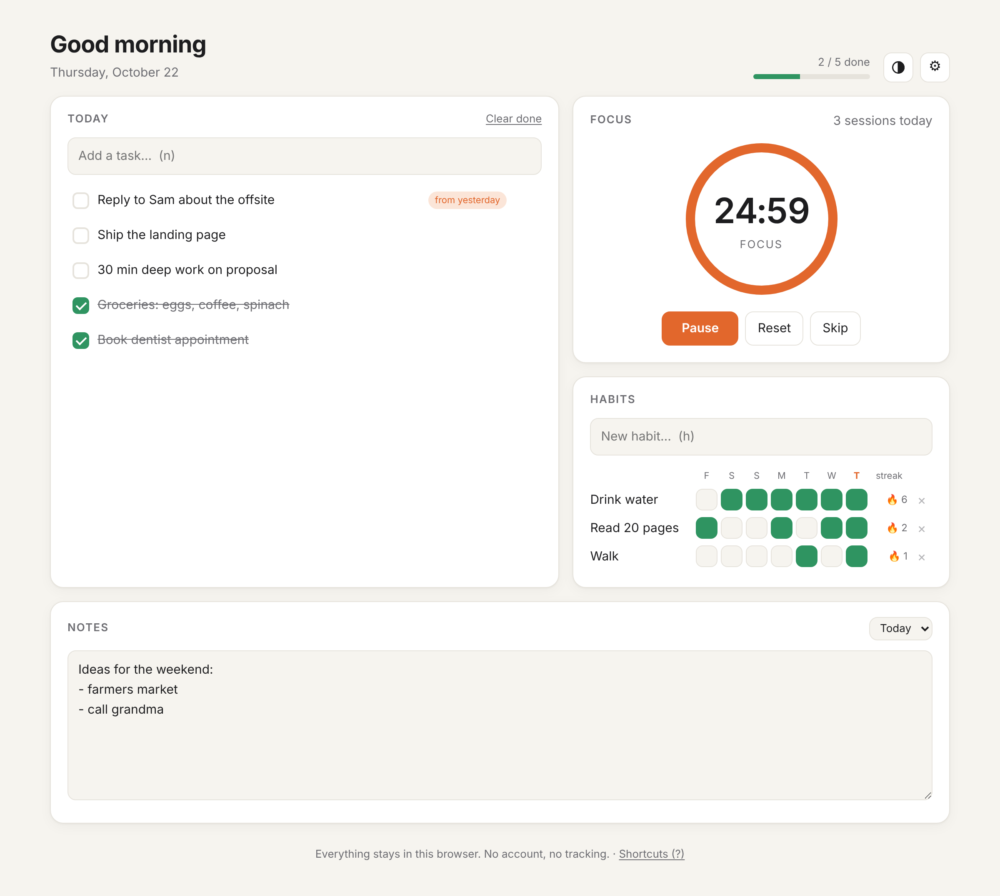
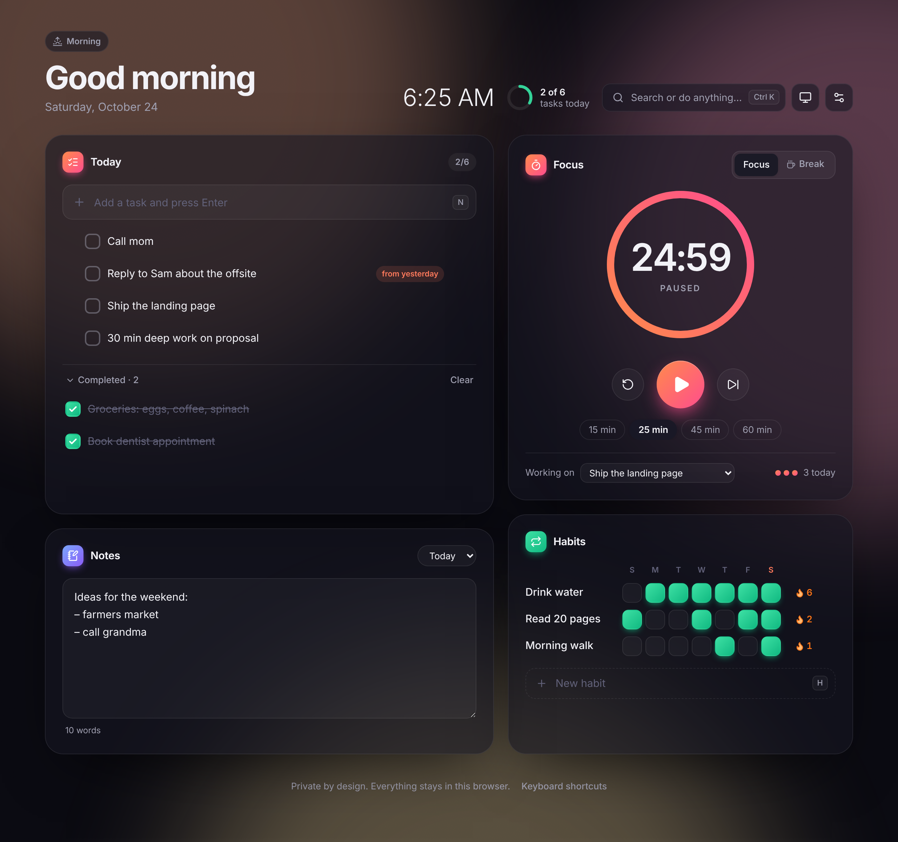
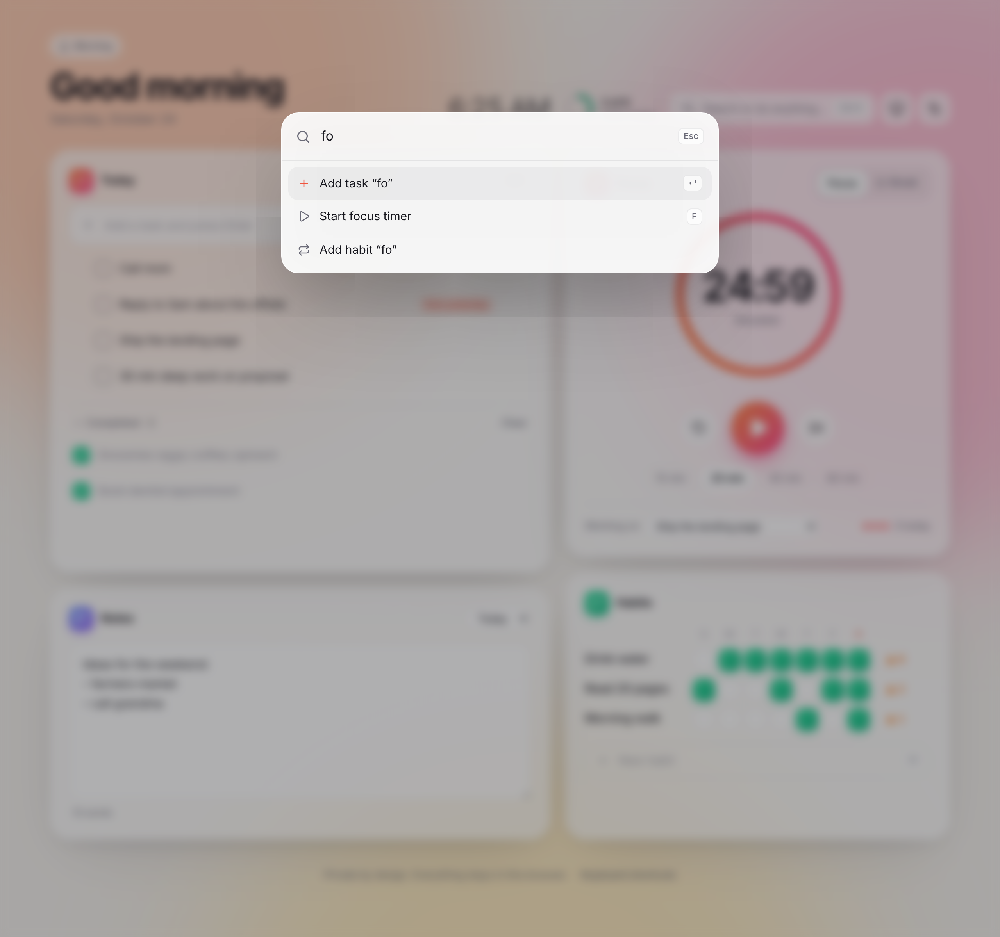

<p align="center">
  
</p>

<h1 align="center">Daylight</h1>

<p align="center">
  <b>Your whole day in one calm tab.</b><br>
  Tasks · Focus timer · Habits · Notes. Private, offline, no sign-up.
</p>

<p align="center">
  <a href="https://coldvini.github.io/99-night-in-the-forrest/"><b>▶ Open Daylight</b></a>
</p>

<p align="center">
  
  
</p>

## Why

Most productivity apps want an account, a subscription, and your data. Daylight is
one small page you keep open all day: what you're doing today, a timer to do it,
the habits you're building, and a scratchpad. Nothing leaves your browser.

## Features

- **Today list.** Add, finish and edit tasks (double-click), and **drag to reorder**. Unfinished tasks **roll over to tomorrow** automatically, tagged "from yesterday", so nothing gets lost. Finish your last task and you get confetti 🎉.
- **Focus timer.** Pomodoro-style focus and break sessions on a glowing progress ring, one-click presets (15/25/45/60 min), and the countdown in the tab title. Link a session to a task, and when the session ends Daylight offers to mark the task done. You get a chime and a desktop notification, and the timer survives reloads.
- **Habits.** A seven-day check grid with 🔥 streaks.
- **Daily notes.** An auto-saving scratchpad for each day, with a word count and past days a click away.
- **Command palette.** Press <kbd>⌘K</kbd> / <kbd>Ctrl K</kbd> and type anything to add a task or habit, start the timer, complete a task, switch theme or export.
- **Undo everywhere.** Deleting a task or habit shows a toast with an Undo button.
- **A background that follows the day.** The aurora shifts from dawn peach to daytime sky, dusk violet and night indigo. Glass cards, smooth spring animations, light and dark mode, and it respects reduced-motion settings.
- **Keyboard first.** <kbd>N</kbd> task · <kbd>H</kbd> habit · <kbd>W</kbd> notes · <kbd>F</kbd> timer · <kbd>T</kbd> theme · <kbd>?</kbd> help.
- **Private by design.** Your data lives in `localStorage`. No server, no analytics, no cookies. Export and import JSON whenever you like.
- **Works offline and installs as an app** (PWA) on desktop and mobile. Open tabs stay in sync.

<p align="center">
  
</p>

## Use it

**Online:** open the link above. To install it, use "Install app" in your browser menu (or "Add to Home Screen" on a phone).

**Make it your new tab page:** set the link as your homepage, or use any "custom new tab URL" extension.

## Develop

Built with React 19, TypeScript, Vite and Motion. You need Node 20 or newer.

```sh
git clone https://github.com/coldvini/99-night-in-the-forrest.git
cd 99-night-in-the-forrest
npm install
npm run dev        # http://localhost:5173
npm test           # unit tests (Vitest)
npm run build      # static site in dist/
```

```
src/
  App.tsx              layout, shortcuts, theme and time-of-day
  store.ts             tiny external store backed by localStorage
  actions.ts, timer.ts everything that changes state
  components/          Tasks, Focus, Habits, Notes, CommandPalette, Settings…
public/sw.js           offline support
```

`dist/` is a plain static site, so you can host it anywhere. Every push to `main` is tested, built and deployed to
GitHub Pages by `.github/workflows/pages.yml`.

## Contributing

Issues and PRs are welcome. The rules are short: no tracking, no accounts, and keep it fast.
Run `npm test` and `npm run build` before opening a PR.

## License

[MIT](LICENSE)
